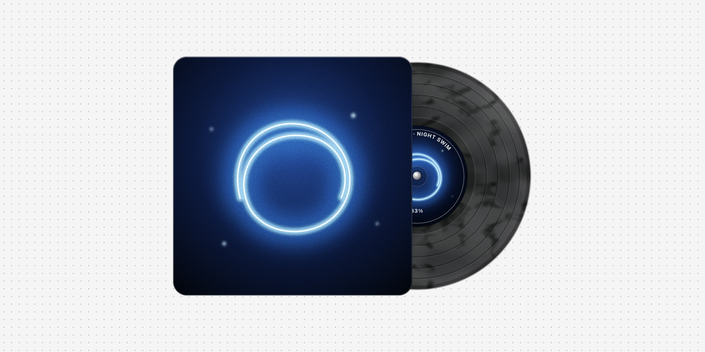
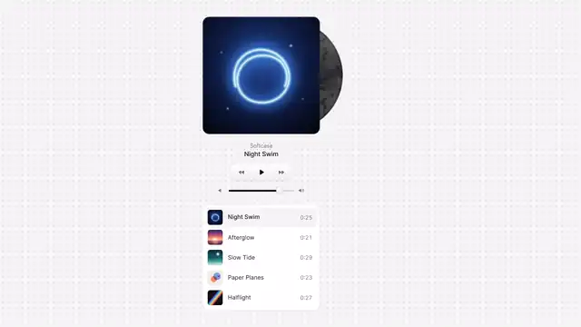

<p align="center">
  
</p>

<p align="center">
  <a href="https://likemiens.com/ui/vinyl-player"><b>Live demo</b></a> ·
  <a href="media/demo.mp4"><b>Video</b></a> ·
  <a href="#quick-start"><b>Quick start</b></a>
</p>

<p align="center">
  Made by Likemiens ·
  <a href="https://x.com/a_varantsov">X</a> ·
  <a href="https://t.me/Likemiens">Telegram</a> ·
  <a href="https://github.com/Likemiens">GitHub</a>
</p>

**Vinyl Player** is a music player as a record sleeve. Press the cover and the vinyl slides out and spins, with the song's cover on its label. A setlist under it changes the songs with the sleeve, and a slider sets the volume.

It is a React component in two files. It plays the files you give it: the songs, their covers and their lengths come from your app.

<p align="center">
  
</p>

## Features

- **The sleeve is the play button.** Press it and the record slides out of the sleeve, spins up and plays; press again and it slides back and coasts to a stop.
- **A record that looks like one.** Smoky vinyl with dark veins and lighter smoke, the grooves, the gaps between songs, the run-out by the label and a metal spindle. The light on the grooves stays put while the record turns under it, as on a real one.
- **Smeared like on camera.** The turning part is drawn several times, spread over a shutter, so the veins and the label smear while it spins and sharpen when it stops. It turns at 7.5 rpm: a real 33⅓ looks frantic at this size.
- **The song's cover on the label.** Printed with a ring, the artist and title along the edge, and 33⅓. Pick another song while it plays and the record dips into the sleeve and comes out with the new label.
- **A setlist that follows.** The highlight glides to the song that is on and fills as it plays; bars dance over its thumbnail. The next song starts when one ends.
- **A matte sleeve.** A fine grain over the print and a light edge, no gloss to fight the art.
- **Previews welcome.** Give a song a `link` and a quiet "listen to the whole song" link stands under its title: play a store's 30-second previews and send people to the rest.
- **Volume in the hand.** A slider of its own: its knob is taken with its offset and never jumps. On iOS the volume belongs to the phone's buttons, so there is no slider.
- **Keyboard and screen readers.** The cover, the buttons and the songs are buttons; the volume is a slider. Every word comes from you.
- **Light.** No dependencies besides React. It respects "reduce motion": the record neither spins nor smears.

## Quick start

Install it:

```bash
npm i @likemiens/vinyl-player
```

Or copy `vinyl-player.tsx` and `vinyl-player.css` into your project, side by side, and import from `./vinyl-player`.

Then give it the songs and its words:

```tsx
import { VinylPlayer, type VinylPlayerLabels } from "@likemiens/vinyl-player"; // brings vinyl-player.css with it

const labels: VinylPlayerLabels = {
  setlist: "Setlist",
  play: "Play",
  pause: "Pause",
  previous: "Previous song",
  next: "Next song",
  volume: "Volume",
};

const songs = [
  { title: "Night Swim", artist: "Softcase", cover: "/covers/night-swim.jpg", src: "/songs/night-swim.mp3", duration: 204 },
  { title: "Afterglow", artist: "Softcase", cover: "/covers/afterglow.jpg", src: "/songs/afterglow.mp3", duration: 187 },
];

export function Records() {
  return <VinylPlayer tracks={songs} labels={labels} />;
}
```

[example.tsx](example.tsx) is a complete version.

> [!NOTE]
> **Next.js:** `vinyl-player.tsx` already starts with `"use client"`. If you pass `onChange`, render it from a client component.

## Props

| Prop | Type | Default | What it does |
|---|---|---|---|
| `tracks` | `VinylPlayerTrack[]` | required | The songs, in the order of the setlist. |
| `labels` | `VinylPlayerLabels` | required | Every word on it. |

### Tracks

| Field | Type | What it is |
|---|---|---|
| `title` | `string` | the song's name |
| `artist` | `string` | who plays it |
| `cover` | `string` | a square image: the sleeve, and the label of the record |
| `src` | `string` | the audio file |
| `duration` | `number`, optional | seconds, shown in the setlist |
| `link` | `string`, optional | where to hear the whole song, when `src` is a preview: a link under the title |

### Labels

`setlist` names the list for screen readers, `play` and `pause` name the cover and the play button, `previous` and `next` the buttons around it, `volume` the slider. These are required. `listen` is the words of the link to the whole song, such as "Listen on Apple Music"; without it no link is shown.

## Callbacks

| Callback | When it is called |
|---|---|
| `onChange({ index, playing })` | The song changed, or it started or stopped playing. |

## Styling

Colours and sizes come from CSS custom properties, set on `.vp` or on a parent with a more specific selector. These are the defaults:

```css
.records .vp {
  --vp-ink: #111;        /* the titles and the play button */
  --vp-quiet: #777;      /* the artist, the times, the other buttons */
  --vp-surface: #fff;    /* the setlist */
  --vp-focus: rgb(12 117 241 / 72%);
  --vp-size: min(280px, 50vw - 8px); /* the cover */
  --vp-peek: 0.2;        /* how far the record shows at rest, part of the cover */
  --vp-out: 0.5;         /* and while it plays */
  --vp-label: 0.44;      /* the label, part of the record */
  --vp-grain: 1;         /* the matte grain, 0 for none */
}
```

The record comes out to the right of the cover by `--vp-out` of its width, so leave that much room beside the player. It uses your page's font.

## Keyboard

| Key | What it does |
|---|---|
| `Tab` | the cover, the buttons, the volume, the songs |
| `Enter` `Space` | play, pause, pick a song |
| `←` `→` `↑` `↓` | the volume, by 5% |
| `Home` `End` | silence, full volume |

## Files

```
vinyl-player.tsx   the component and its types
vinyl-player.css   its styles and colours
example.tsx        a complete usage, to start from
AGENTS.md          notes for coding agents
media/             the cover, the preview and the video
```

## Credits

After the player on [Allagi](https://allagi.webflow.io)'s site, a cover with a disc behind it, and the records of Instagram and [MD Vinyl](https://designspells.com/spells/skeuomorphic-record-player-when-listening-to-music-in-md-vinyl), as [Design Spells](https://designspells.com/spells/vinyl-record-that-spins-when-the-song-is-playing-on-instagram) shows them: the speed, the proportions and the shade of the vinyl are measured from their videos. The songs and covers of the demo are synthesised and drawn for it. The code is this project's own.

## Author

Made by **Likemiens**. Say hi or share what you built: [X](https://x.com/a_varantsov) · [Telegram](https://t.me/Likemiens) · [GitHub](https://github.com/Likemiens)

## License

[MIT](LICENSE) © Likemiens
